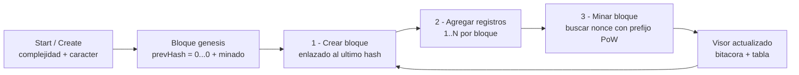
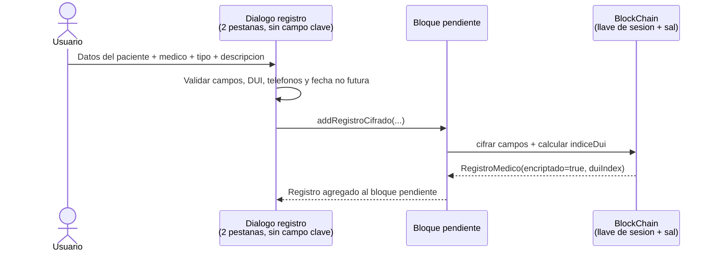
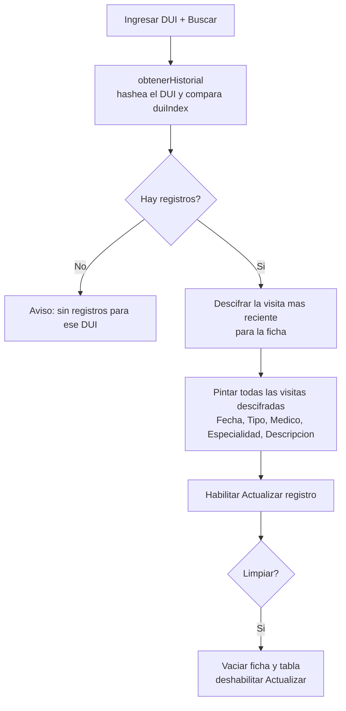
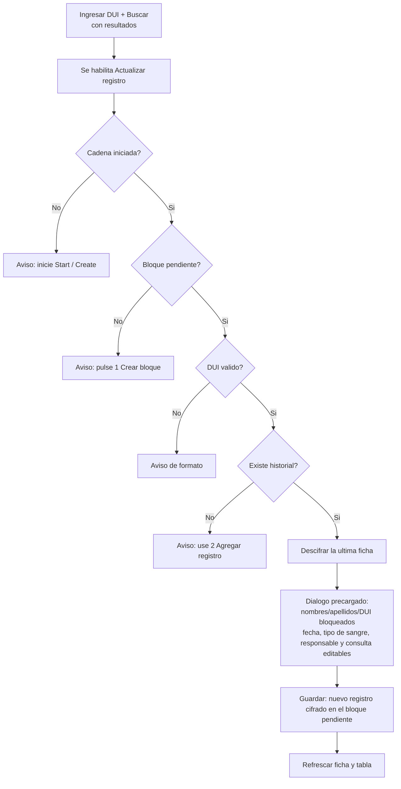

# Historial Médico en Blockchain

> Aplicación de escritorio (Swing) que registra historiales médicos en una cadena de bloques local con prueba de trabajo (SHA-256) y cifrado transparente AES. No usa base de datos ni red: la cadena, la llave de sesión y la sal viven únicamente en memoria. El DUI se guarda cifrado y además como índice hash, de modo que se puede buscar sin necesidad de descifrar toda la cadena.

## 1. Historial de cambios

| Versión | Fecha | Descripción | Autor |
|---------|-------|-------------|-------|
| v1.0.0 | 01-11-2026 | Creación de la documentación | Daniel Mancia |

## 2. Descripción del proyecto

Sistema local que simula un servidor de historiales médicos sobre blockchain:

- Cada **bloque** agrupa registros médicos (paciente + médico + tipo + descripción). El bloque génesis se crea y se mina vacío (0 registros); los bloques siguientes admiten 1 o más registros antes de minarse.
- Cada bloque se **mina** por fuerza bruta: se busca un `nonce` tal que `SHA-256(contenido + nonce)` empiece con el prefijo de prueba de trabajo configurado (por ejemplo `0000`).
- Todo registro nuevo se **cifra automáticamente** con AES usando una llave de sesión generada al iniciar la cadena, sin password del usuario y sin claves hardcodeadas. Se cifran nombres, apellidos, DUI, fecha de nacimiento, tipo de sangre, datos del responsable, dirección, médico, especialidad, JVPM, tipo de registro y descripción.
- En claro solo queda el índice `duiIndex = SHA-256(DUI + sal)`. El DUI también existe dentro del campo cifrado, pero nunca como texto plano.
- El **historial de un paciente** se reconstruye hasheando el DUI consultado y comparando contra `duiIndex`; la ficha y la tabla se muestran descifradas automáticamente. Los registros antiguos marcados como no cifrados se siguen leyendo en claro.
- La cadena no se valida ni se persiste: es una demostración educativa del encadenamiento por hash y de la prueba de trabajo.

## 3. Objetivos

1. Demostrar los conceptos de bloque, hash encadenado y prueba de trabajo.
2. Registrar eventos clínicos con datos del paciente y del médico responsable.
3. Proteger la confidencialidad con cifrado simétrico transparente, incluido el DUI.
4. Proveer una interfaz de visualización (bitácora, tabla de bloques, ficha del paciente y tabla de visitas).

## 4. Alcance

### Incluye:

- Creación de la cadena y minado del bloque génesis.
- Creación y minado de bloques con dificultad y carácter de minado configurables.
- Registro cifrado de pacientes, responsables y consultas médicas.
- Catálogo fijo de médicos con especialidad y JVPM.
- Consulta de historial por DUI con ficha del paciente autodescifrada.
- Actualización de datos de una ficha existente mediante una nueva versión cifrada dentro de un bloque pendiente.
- Bitácora de eventos y visor de bloques.

### No incluye:

- Persistencia en disco: al cerrar la aplicación se pierden la cadena, la llave y la sal.
- Red P2P o sincronización entre nodos.
- Validación automática de la integridad de la cadena.
- Gestión de usuarios, roles o autenticación.
- Historia clínica compartida entre varias instituciones.
- Suite de pruebas automatizadas.

### Limitaciones conocidas

- El cifrado usa `AES/ECB/PKCS5Padding`: es determinista y no oculta patrones; se eligió por simplicidad didáctica.
- La sal es única por cadena, por lo que un mismo DUI produce siempre el mismo `duiIndex` dentro de esa sesión.
- La llave de sesión solo existe en memoria y no se puede exportar ni recuperar.
- No se valida el dígito verificador del DUI, solo su formato.
- Los nombres, JVPM y datos del catálogo de médicos son ficticios.
- Volver a pulsar `Start / Create` reinicia la cadena y descarta todos los bloques y registros anteriores.

## 5. Estructura del proyecto

```text
Blockchain_HistorialMedico/
├── pom.xml
├── README.md
└── src/main/java/
    ├── blockchain/
    │   ├── Block.java
    │   ├── BlockChain.java
    │   ├── Cifrado.java
    │   ├── Medico.java
    │   ├── Paciente.java
    │   ├── RegistroMedico.java
    │   └── SHA256.java
    └── forms/
        └── frmHistorialMedico.java
```

> La interfaz no usa archivo `.form` de NetBeans: todo el layout Swing se construye por código en `frmHistorialMedico`, repartido en métodos como `buildHeader`, `buildTopPanel`, `buildCenterPanel` y `buildBottomPanel`.

## 6. Funcionalidades

| Módulo | Funcionalidad | Detalle |
|--------|---------------|---------|
| Cadena | Iniciar blockchain | Crea la cadena, genera llave AES de sesión y sal de 16 bytes, y mina el bloque génesis con `previousHash` de 64 ceros. Reinicia cualquier cadena previa. |
| Cadena | Crear bloque | Agrega un bloque pendiente enlazado al `hash` del último bloque. |
| Cadena | Minar bloque | Busca por fuerza bruta el `nonce` cuyo hash cumpla el prefijo y sella el bloque con `register(nonce, hash)`. |
| Cadena | Bitácora y visor | La bitácora registra hash del génesis, bloques propuestos, nonce, hashes y tiempo de minado en ms. El visor lista todos los bloques con hashes truncados. |
| Clínico | Agregar registro | Diálogo de dos pestañas: "Datos del paciente" y "Consulta medica". Un bloque admite N registros antes de minarse. |
| Clínico | Catálogo de médicos | Seis médicos fijos con especialidad y JVPM. El combo "Tipo de registro" se llena según la especialidad del médico seleccionado. |
| Clínico | Consulta por DUI | Busca en toda la cadena por `duiIndex`, muestra la ficha de la visita más reciente y la tabla con todas las visitas descifradas. |
| Clínico | Actualizar registro | Requiere un DUI existente y un bloque pendiente. Precarga la ficha descifrada, bloquea nombres, apellidos y DUI, permite editar fecha de nacimiento, tipo de sangre, datos del responsable y la nueva consulta, y guarda una nueva versión cifrada. |
| Seguridad | Cifrado transparente | Al guardar, cifra los campos sensibles con la llave de sesión y calcula el `duiIndex`. Al consultar, descifra automáticamente para mostrar. |
| Validación | Formatos de El Salvador | DUI `NNNNNNNN-N`, teléfono `NNNN-NNNN`, fecha de nacimiento no futura y campos obligatorios. Ver sección 8. |

---

## 7. Flujos

### 7.1 Ciclo de vida del bloque



---

### 7.2 Agregar registro (cifrado transparente, sin clave de usuario)



> El diálogo no pide clave: `BlockChain` cifra con su llave de sesión y guarda `encriptado=true`. El hash del bloque cubre los blobs cifrados y el índice, nunca texto claro.

---

### 7.3 Consulta de historial por DUI



---

### 7.4 Actualizar registro existente



> La actualización no reescribe el pasado: agrega una nueva versión al bloque pendiente. La ficha muestra la visita más reciente y la tabla conserva todas las versiones.

## 8. Seguridad y formatos (El Salvador)

| Aspecto | Implementación |
|---------|----------------|
| Prueba de trabajo | `SHA-256` con prefijo configurable. La complejidad es la longitud del prefijo (1 a 6) y el carácter puede ser `0`, `1` o `a`. Complejidad 4 equivale a unos 65 536 intentos promedio. |
| Cifrado | `AES/ECB/PKCS5Padding`, salida en Base64. Se usa una llave de sesión AES de 256 bits; si el entorno tiene JCE restringido, se genera de 128 bits. |
| Llave y sal | La llave se genera con `SecureRandom` al crear la `BlockChain`; la sal es de 16 bytes aleatorios y se representa en hexadecimal. Ambas viven solo en memoria y se pierden al cerrar. |
| Índice de DUI | `duiIndex = SHA-256(DUI recortado + sal)`. Permite buscar sin comparar texto claro. |
| Campos cifrados | Nombres, apellidos, DUI, fecha de nacimiento, tipo de sangre, familiar responsable, DUI del responsable, parentesco, teléfono y dirección del responsable; nombre, especialidad y JVPM del médico; tipo de registro y descripción. |
| Cobertura del hash | El hash del bloque incluye los registros ya cifrados y el `duiIndex`; nunca incluye los valores en claro de un registro nuevo. |
| DUI | Regex `\d{8}-\d` (ejemplo `04521678-9`). No valida el dígito verificador oficial. |
| Teléfono | Regex `\d{4}-\d{4}` (ejemplo `7123-4567`). |
| Fecha de nacimiento | Se selecciona con un spinner que no permite fechas futuras y se vuelve a validar al guardar. |
| Campos obligatorios | Nombres, apellidos, DUI del paciente, médico y descripción. |
| Campos opcionales | Familiar responsable, dirección del responsable, DUI del responsable y teléfono del responsable. El DUI y el teléfono se validan solo si se escriben. |
| JVPM | Junta de Vigilancia de la Profesión Médica. Los valores del catálogo son de ejemplo y no corresponden a médicos reales. |

---

## 9. Catálogo de médicos y tipos de registro

| Médico | Especialidad | JVPM |
|--------|--------------|------|
| Carlos Daniel Ramirez | Medicina General | 4521 |
| Ana Lucia Portillo | Pediatria | 3390 |
| Luis Fernando Melendez | Cardiologia | 5871 |
| Karla Alejandra Hidalgo | Ginecologia | 2298 |
| Jose Melvin Alas | Traumatologia | 6120 |
| Sofia Alexandra Contreras | Dermatologia | 7745 |

Tipos de registro disponibles por especialidad:

| Especialidad | Tipos |
|--------------|-------|
| Medicina General | Consulta general, Resfriado comun, Control de rutina, Referencia a especialista, Certificado medico |
| Pediatria | Control de nino sano, Vacunacion, Desarrollo psicomotor, Enfermedad respiratoria, Alergia alimentaria |
| Cardiologia | Hipertension arterial, Arritmia, Electrocardiograma, Control post-infarto, Colesterol alto |
| Ginecologia | Control prenatal, Papanicolaou, Planificacion familiar, Ecografia, Menopausia |
| Traumatologia | Fractura, Esguince, Fisioterapia, Dolor de espalda, Cirugia ortopedica |
| Dermatologia | Acne, Alergia cutanea, Revision de lunares, Psoriasis, Cirugia menor de piel |

Tipos de sangre disponibles: `O+`, `O-`, `A+`, `A-`, `B+`, `B-`, `AB+`, `AB-`, `Pendiente de examen`, `Desconocido / No especifica`.

Parentescos disponibles: `Padre`, `Madre`, `Conyuge`, `Hijo/a`, `Hermano/a`, `Otro`.

---

## 10. Guía de uso

1. **Iniciar:** dejar complejidad `4` (rango 1-6) y carácter `0` (opciones `0`, `1`, `a`) → `Start / Create`. Se crea y mina el bloque génesis.
2. **1  Crear bloque** para tener un bloque pendiente.
3. **2  Agregar registro** y completar el diálogo:
   - Pestaña "Datos del paciente": nombres, apellidos, DUI (por ejemplo `04521678-9`), fecha de nacimiento no futura, tipo de sangre, familiar responsable, DUI del responsable, parentesco, teléfono del responsable y dirección.
   - Pestaña "Consulta medica": médico (se muestra especialidad y JVPM), tipo de registro según la especialidad y descripción o diagnóstico.
   - Pulsar `Guardar registro`.
4. Repetir el paso 3 para agregar más registros al mismo bloque.
5. **3  Minar bloque**. La bitácora muestra el nonce, el hash y el tiempo de minado; el visor se actualiza.
6. **Consultar:** ingresar un DUI y pulsar `Buscar`. Se muestra la ficha con los datos de la visita más reciente y la tabla con todas las visitas descifradas. `Limpiar` vacía la búsqueda, la ficha y la tabla.
7. **Actualizar:** crear un bloque pendiente, ingresar un DUI existente y pulsar `Buscar`. Con resultados visibles se habilita `Actualizar registro`. El diálogo se abre precargado; nombres, apellidos y DUI están bloqueados, mientras fecha de nacimiento, tipo de sangre, datos del responsable y la nueva consulta son editables. Al guardar se agrega otra versión cifrada al bloque pendiente y se refresca la consulta.

> La bitácora y el visor de bloques nunca muestran DUIs, nombres ni diagnósticos en claro. Toda la información clínica se ve en claro únicamente en la ficha y la tabla de historial tras una búsqueda.

## 11. Glosario

| Término | Significado |
|---------|-------------|
| Bloque génesis | Primer bloque de la cadena, con `previousHash` de 64 ceros y sin registros. |
| Nonce | Número que se varía hasta que el hash cumple la dificultad. |
| PoW | Proof of Work: prueba de trabajo por fuerza bruta. |
| JVPM | Junta de Vigilancia de la Profesión Médica (colegiación en El Salvador). |
| DUI | Documento Único de Identidad (El Salvador). |
| duiIndex | Hash `SHA-256(DUI + sal)` usado para buscar sin exponer el DUI. |

---
<p align="center">
  <em>Daniel Mancia · Backend Developer - 01 de Noviembre de 2026</em> 
</p>